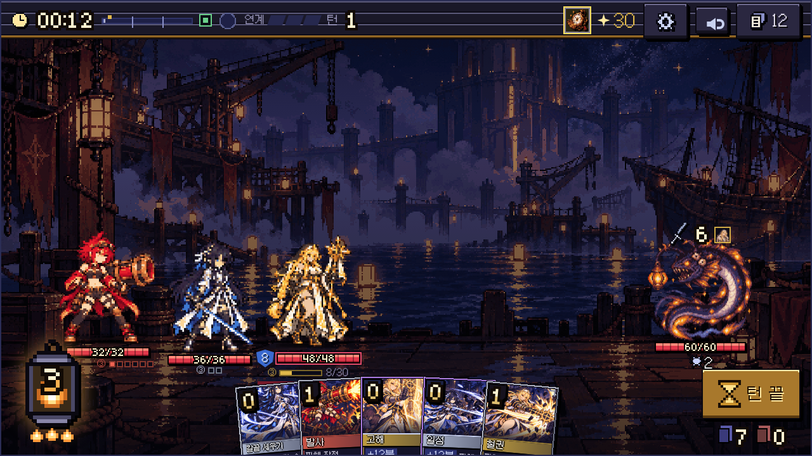
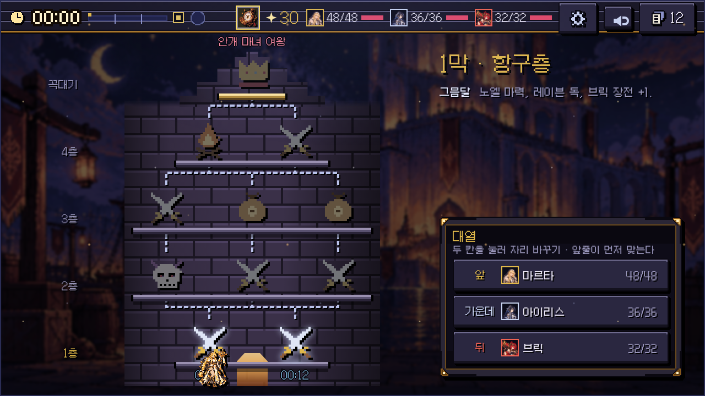
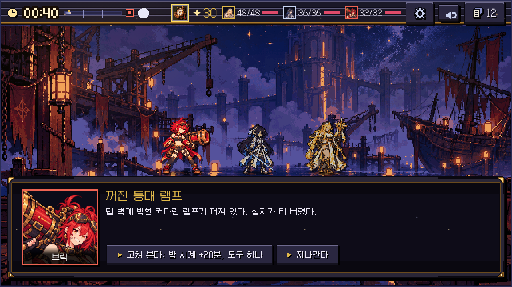
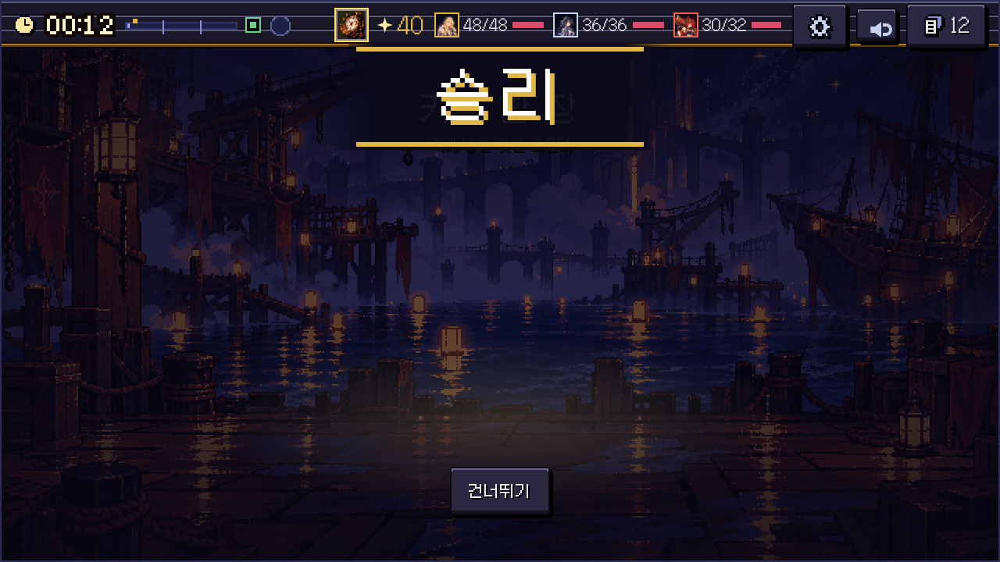

# 야경단 개발 일지 (10/30)

이번 주에는 새로 넣은 기능 없이 화면만 계속 고쳤습니다.

게임은 돌아가는데 막상 띄워 놓고 보니 너무 흔한 모양이더라고요. 남색 상자에 금색 테두리, 안에는 설명 글이 잔뜩 있고, 거의 모든 화면이 그렇게 생겼었습니다.

제일 오래 붙잡고 있던 건 전투 화면입니다. 왼쪽 에너지를 금색 동그라미에서 등불로 바꿨고, 숫자들은 글꼴 대신 도트로 하나씩 찍어서 넣었습니다. 턴 끝 버튼에는 모래시계를 그려 넣었는데, 더 낼 카드가 없으면 뒤집히면서 알려 줍니다.

캐릭터가 공격할 때 그림을 늘리고 기울여서 움직임을 냈었는데, 도트가 뭉개져서 빼 버렸습니다. 지금은 위치만 움직이고 자세는 동작 그림을 바꿔 끼우는 식입니다.

지도는 처음부터 다시 만들었습니다. 탑을 올라가는 게임인데 정작 지도에는 탑이 없었거든요. 이제는 1층부터 꼭대기까지 탑이 세로로 서 있고, 칸을 누르면 맨 앞 동료가 계단을 따라 올라갑니다. 탑 그림은 아직 임시라서 다음에 제대로 된 그림으로 바꿀 예정입니다.

사건이랑 휴식 화면은 가운데 상자를 없애고 동료들을 바닥에 세웠습니다. 대사도 한 글자씩 나오게 바꿨고요.

카드 그림도 72장 들어왔습니다. 그동안은 같은 그림을 여러 카드에 돌려 쓰고 있었어서, 들어오고 나니 화면이 꽤 달라 보였습니다.

그리고 대사를 보다가 "…"가 이백 줄 넘게 붙어 있는 걸 발견해서 대부분 지웠습니다. 진짜 머뭇거리는 장면 몇 개만 남겨 뒀습니다.

다음 주에는 남은 카드 그림 네 명분이랑 지도 탑 그림을 넣어 보려고 합니다.
