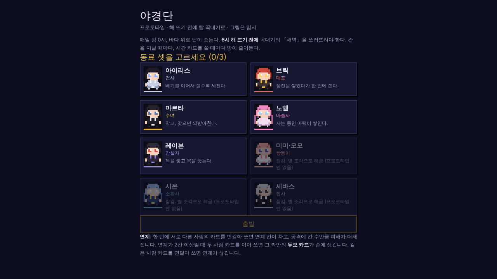
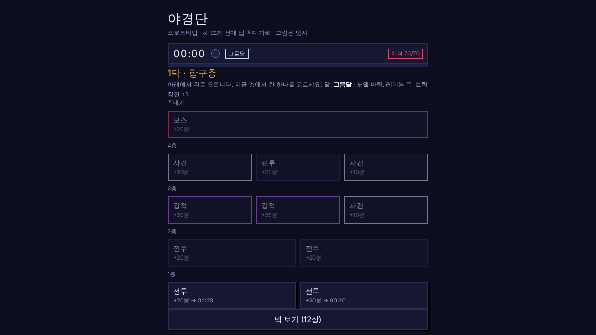
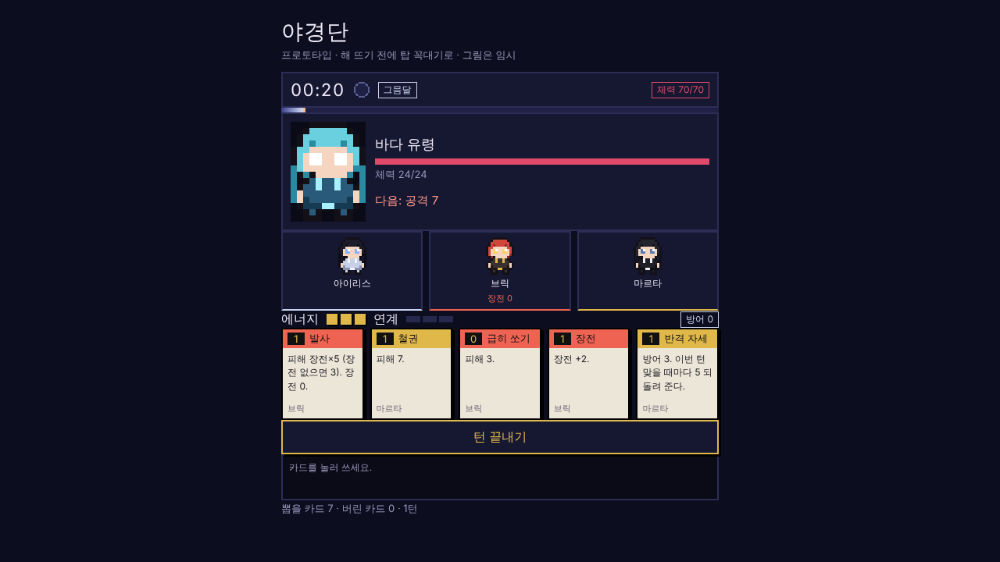

# 야경단 개발 일지 - 처음 만들 때

처음에는 HTML 파일 하나로 시작했습니다. 정말 되는지만 보려고 만든 프로토타입이라 그림도 다 임시로 찍은 도트였습니다.

밤 0시에 바다 위로 탑이 솟고, 해 뜨는 6시 전에 꼭대기까지 올라가야 한다는 설정은 이때부터 있었습니다. 칸을 지날 때마다 시간이 흐르고, 강한 카드는 에너지 대신 시간을 씁니다. 결국 "싸워서 강해질지, 시간을 아낄지"를 계속 고르게 되는데, 이게 재밌는지가 제일 궁금했습니다.

지도는 그냥 칸을 위아래로 쌓아 놓은 목록이었고요.

전투도 지금이랑 많이 달랐습니다. 동료 셋이 체력 하나를 같이 쓰고, 적은 한 마리씩만 나왔습니다. 그래도 서로 다른 동료 카드를 번갈아 쓰면 연계가 차고, 인연 있는 둘을 이어 쓰면 듀오 카드가 생기는 건 이 버전에도 들어가 있었습니다. 해 보니 생각보다 손이 계속 가서, 이걸 제대로 만들어 보기로 했습니다.

본격적으로 옮기면서 바꾼 것들이 꽤 됩니다. 화면을 가로로 돌렸고, 체력을 동료마다 따로 두고 앞·가운데·뒤 대열을 만들었습니다. 적이 누구를 노리는지 보이니까 자리를 바꾸는 판단이 생기더라고요. 동료는 다섯 명에서 스물두 명까지 늘었고, 동료마다 에피소드도 세 편씩 붙였습니다.

그림은 GPT로 그리고 있습니다. 처음에 같은 캐릭터를 도트 굵기만 다르게 네 장 그려 보고, 그중에 제일 마음에 드는 걸 기준으로 정했습니다. 그 뒤로는 모든 그림을 그 한 장에 맞춰 그리게 하고 있습니다.

지금은 이렇게 됐습니다. 프로토타입이랑 나란히 놓고 보면 같은 게임인가 싶긴 한데, 시간을 아낄지 말지 고민하는 건 그때랑 똑같습니다.
