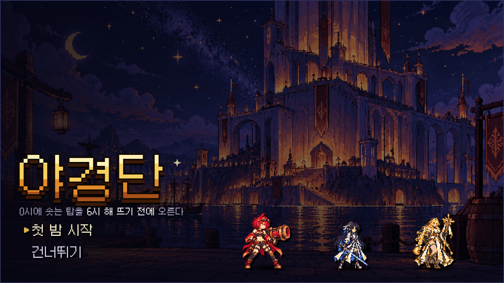
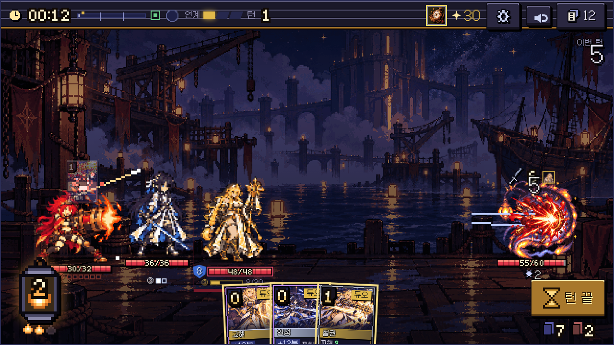
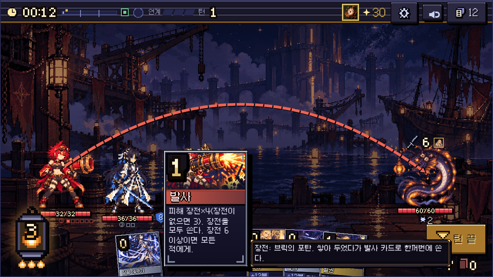
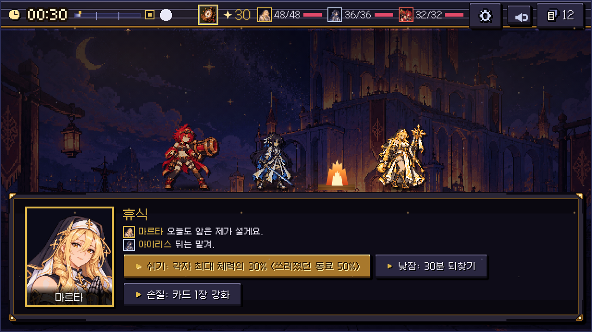
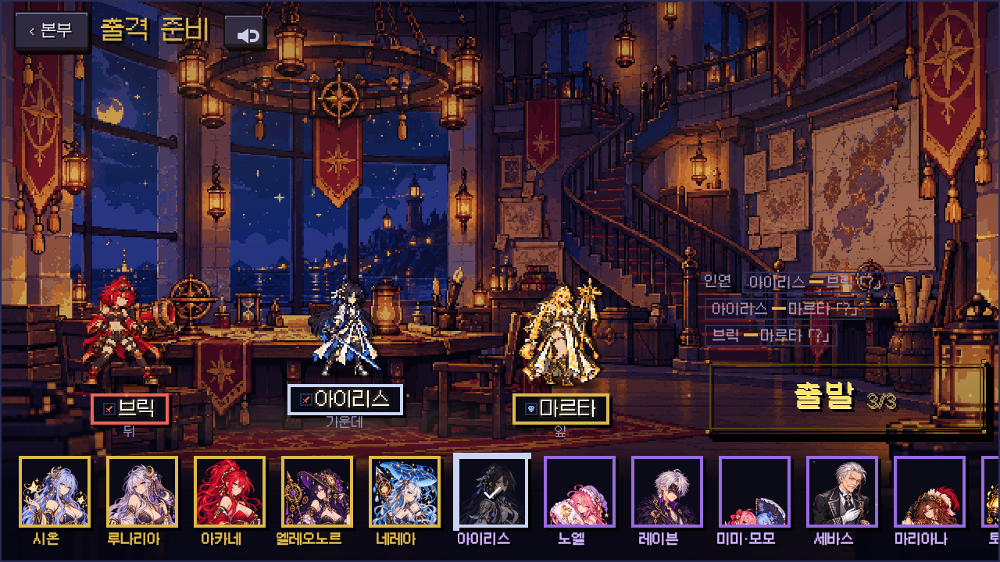
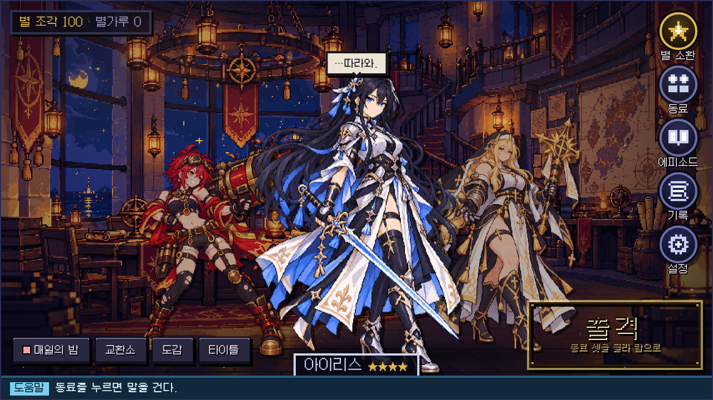
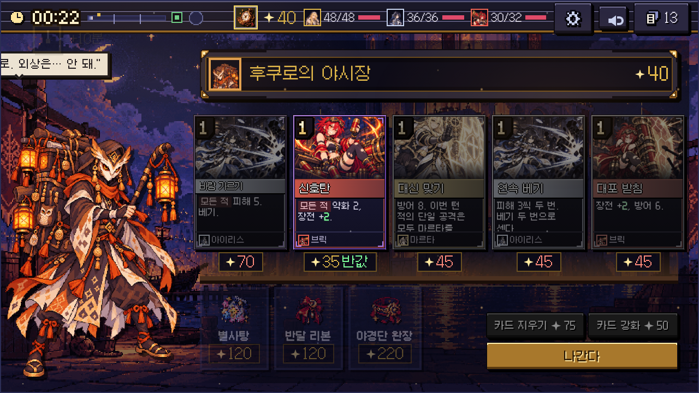
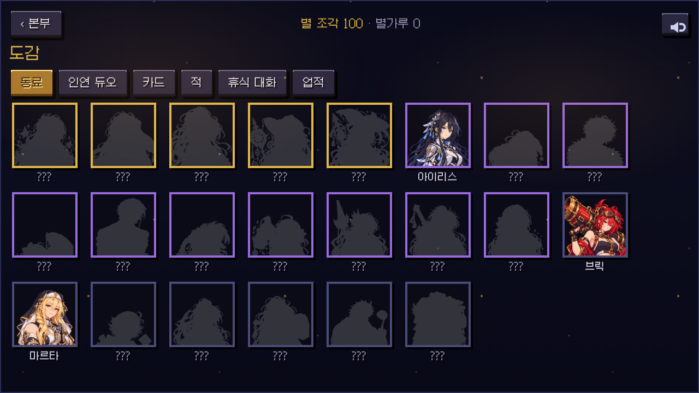
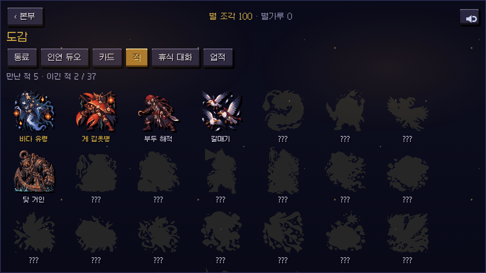
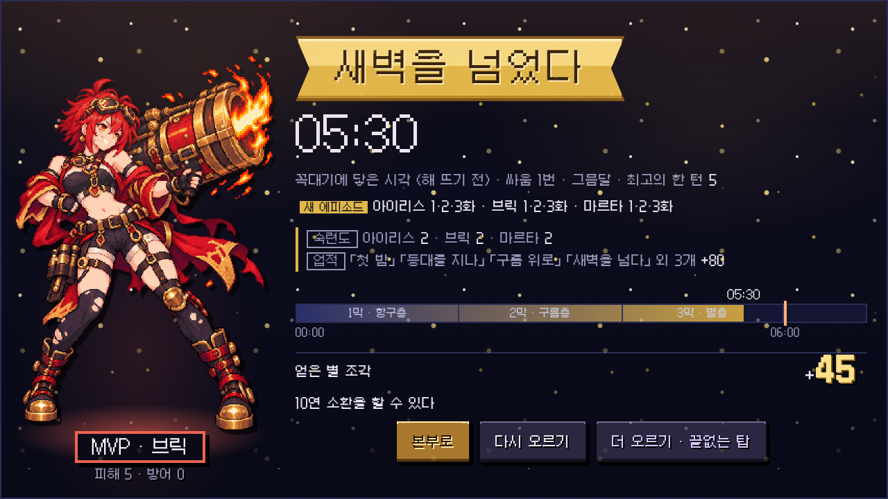

# 야경단 개발 일지 · 10월 30일

## 이번 주 한 줄 요약
"AI가 만든 게임 같다"는 말을 듣지 않으려고 화면을 거의 다 뜯어고쳤다.

## 무슨 게임인가
매일 밤 0시, 바다 위로 탑이 솟는다. 해가 뜨는 6시 전에 꼭대기까지 올라가야 도시에 아침이 온다.
동료 셋을 골라 탑을 오르는 덱빌딩 로그라이크다. 카드를 쓸 때마다 밤 시계가 흐르고, 6시를 넘기면 적이 강해진다. 7시가 되면 탑이 무너진다.

## 문제는 "어디서 본 것 같다"였다
기능은 다 돌아갔다. 그런데 화면을 띄워 놓고 보면 어딘가 남이 만든 템플릿 같았다.
남색 반투명 네모에 금색 테두리. 모든 화면이 그 상자 하나로 찍혀 나왔고, 상자 안에는 설명 글이 빽빽했다.
전투에서는 캐릭터 그림 한 장을 늘였다 줄였다 기울여서 움직임을 냈는데, 그게 도트를 일그러뜨려 고무처럼 보였다.

그래서 이번 주에는 새 기능을 하나도 넣지 않았다. 있는 화면을 하나씩 다시 짰다.

## 전투: 그림을 비틀지 않는다
- 도트 그림은 회전시키거나 비정수로 늘이면 픽셀이 뭉개진다. 움직임은 위치 이동과 밝기만 쓰고, 자세는 동작 칸을 바꿔 끼워서 낸다.
- 피해 숫자와 타격 이펙트가 캐릭터 머리 위 허공에 뜨던 문제를 고쳤다. 그림의 투명한 여백까지 몸으로 쳐서 생긴 일이었다. 지금은 실제 몸 위치를 재서 거기에 붙인다.
- 적이 동료 몸을 뚫고 들어가던 돌진은 몸 앞에서 멈추게 했다.
- 포탄 궤적이 점선처럼 끊겨서 "????!!!"처럼 보였는데, 이어진 줄이 동료들 머리 위로 휘어 날아가게 바꿨다.

## 전투 UI: 웹 글꼴 숫자를 버렸다
"에너지 3/3"을 금색 동그라미에 글꼴로 찍어 두니 딱 그 느낌이 났다. 어느 게임에나 있는 그 모양.

- 에너지는 쇠 등불로 바꿨다. 유리 안에서 불이 타고, 에너지를 다 쓰면 꺼진다.
- 숫자는 전부 직접 찍었다. 4×6 칸짜리 도트 숫자에 검은 테두리를 두르고, 위아래를 두 색으로 칠했다. 에너지, 카드 비용, 체력, 시계, 턴, 더미 수까지 다 이걸로 나온다.
- 턴 끝 버튼은 놋쇠판에 모래시계를 넣었다. 더 낼 카드가 없으면 모래시계가 뒤집힌다.
- 카드에 커서를 대면 크게 올라오고, 옆에 규칙 설명이 붙는다.

## 화면 틀: 쇠판과 놋쇠 꺾쇠
상자와 버튼은 CSS 테두리를 쓰지 않고, 글자로 그린 도트 그림에서 틀을 뽑아 쓴다.
판은 쇠판 네 귀에 놋쇠 꺾쇠를 박았다. 버튼은 아래에 두꺼운 턱이 있어서 누르면 턱이 사라지며 내려앉는다.
도구 하나만 다시 돌리면 게임 전체 틀이 같이 바뀐다.

사건과 휴식은 원래 화면 한가운데 글 상자를 띄우고, 구석에 동료 일러스트를 잘라 붙였다. 지금은 동료 셋이 바닥에 서 있고, 아래 대화 창에서 글이 한 글자씩 찍힌다. 휴식에는 모닥불을 피웠다.

## 지도: 정말로 탑을 오른다
예전 지도는 왼쪽에서 오른쪽으로 글 상자를 늘어놓은 표였다. 탑을 오르는 게임인데 탑이 안 보였다.
지금은 아래 1층부터 꼭대기까지 세로로 선 탑이다. 층마다 돌 난간이 있고, 칸은 아이콘만 난간 위에 놓인다. 칸을 고르면 맨 앞 동료가 꺾인 계단을 따라 올라간다.

## 출격 준비, 본부, 야시장
- 동료 고르기는 정보를 욱여넣은 상자 여덟 칸을 치웠다. 아래에 얼굴 한 줄을 두고, 고른 셋이 본부 바닥에 선다.
- 본부는 말을 걸면 말풍선이 뜨고, 옆 동료 크기를 대표와 비슷하게 맞춰서 단체 사진처럼 보이게 했다.
- 야시장 상인은 원래 한자 한 글자짜리 아이콘이었는데, 이제 얼굴과 진열대가 생겼다.

## 카드 그림이 들어왔다
그림은 GPT에게 맡긴다. 이번 주에 동료 15명 분 카드 그림이 들어와서, 지금은 18명 72장이 있다.
전에는 같은 종류 카드가 2등신 임시 그림을 그대로 돌려 썼는데, 이제 동료마다 공격·방어·스킬·필살 장면이 따로 있다.

카드를 고르면 그 카드가 위쪽 덱 버튼으로 날아간 뒤에 다음 화면으로 넘어간다. 작은 차이인데 이게 있고 없고가 꽤 크다.

## 글도 손봤다
화면만 문제가 아니었다. 대사 215줄이 "…"로 시작하거나 끝났다. 모두가 같은 박자로 머뭇거리니 기계가 쓴 티가 났다.
말 없는 장면과 진짜로 망설이는 순간만 남기고 정리했다. 카드 설명도 한 틀로 맞췄다. "장전 0" 같은 문장은 "장전을 모두 쓴다"로 바꿨다.

## 도감과 결과
도감의 못 만난 동료는 빈 검은 네모였다. 이제 그 동료 실루엣이 보인다. 적 탭에는 실제 적 그림이 나온다.

결과 화면은 계산서처럼 줄줄이 적혀 있던 걸 줄였다. MVP가 크게 서고, 도착 시각과 얻은 별 조각만 크게 보인다.

## 다음 주
- 남은 카드 그림 넷(라일라, 도라, 고든, 후쿠로)
- 그려 넣은 UI 틀과 로고
- 지도 탑 그림 (지금은 코드로 칠한 돌벽이다)
